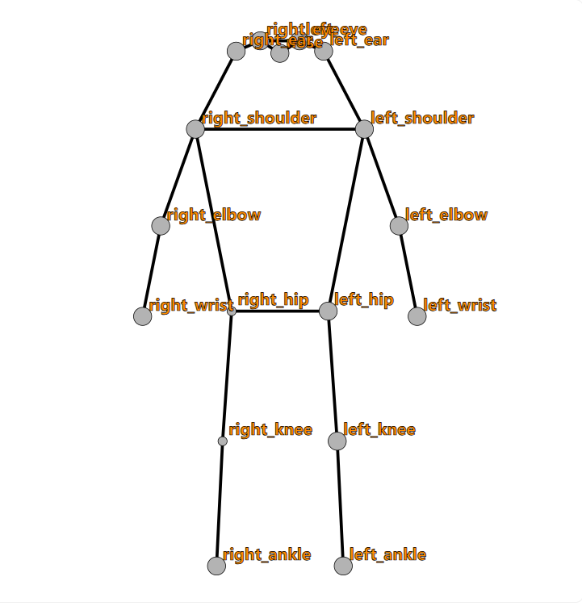
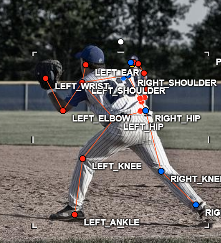
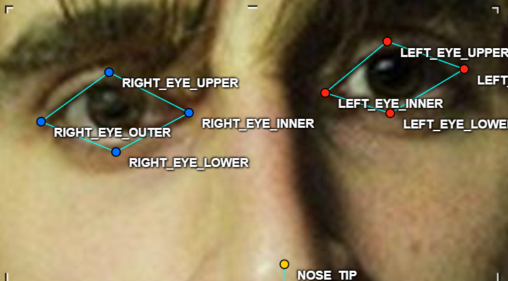
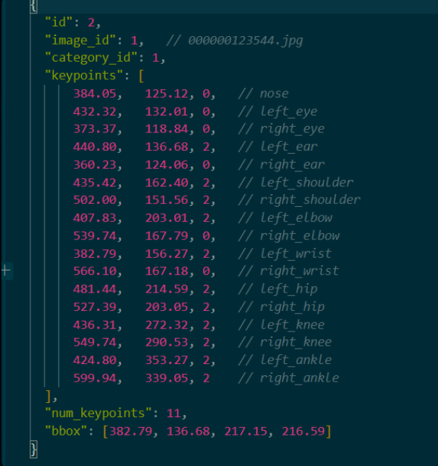

# Báo cáo cá nhân — PhamQuangHuy-2A202604055

Dữ liệu: 12 ảnh người COCO val2017 (Lin et al., 2014) và 8 ảnh chân dung Wikimedia Commons, chỉ dùng trong lớp.

## 0. Thông tin học viên

- Họ tên: Phạm Quang Huy
- MSSV: 2A202604055
- Email:[huyde1357@gmail.com]  
- Link repository: https://github.com/feedfoot/K5-L2-Day04-PhamQuangHuy-2A202604055-KeypointPose-Student.git
- Phiên bản CVAT (Help → About): 2.74.1
- Máy: hệ điều hành Windows 11 Pro · RAM 16 GB · chạy CVAT chế độ đầy đủ
- Bộ ảnh (`src/exports/assignment.json` do `lab.py setup` tạo): có
- Giờ bắt đầu:4h45
- Giờ kết thúc:7h

## 1. Kiểm tra label (CP0)

| Label | Kiểu | Số điểm | Tên điểm đúng bảng của lab? | Đúng thứ tự? | Số cạnh |
|---|---|---:|---|---|---:|
| `person` | Skeleton | 17 | Có | Có | 19 |
| `face` | Skeleton | 13 | Có | Có | 13 |

Mẫu `person` dựng theo người quay mặt về camera (các điểm `left_*` nằm bên phải khung mẫu)? Có

Cách đổi cờ `occluded` / `outside` cho **một điểm** trên phiên bản CVAT này (một câu):

Rê chuột vào đúng điểm cho nó sáng lên rồi bấm `Q` (occluded) hoặc `O` (outside), hoặc chuột phải vào điểm để chọn trong menu; bấm lại phím lần nữa để tắt cờ, chỉ điểm đó bị đổi.

## 2. Số lượng đã gán và thời gian (CP1, CP2)

| Nhóm ảnh | Số ảnh | Số skeleton đã gán | Số người dưới 60 px (không gán) | Số poster / gương / màn hình bỏ qua | Thời gian (phút) |
|---|---:|---:|---:|---:|---:|
| `easy` | 5 | 5 | | | |
| `occluded` | 3 | 5 | | | |
| `back` | 2 | 5 | | | |
| `small` | 1 | 1 | | | |
| `crowd` | 1 | 3 | | | |
| `faces` | 8 | 8 | — | | |

- Số ảnh người đã xong ở mốc phút 105: 10 / 10
- Thời gian thực tế (phút): CP1 30 · CP2 30 · CP3 20
- Ảnh tốn thời gian nhất là ảnh nào, vì sao?

Ảnh `000000123544.jpg` (bóng chày, nhóm `back`). Ảnh có 3 người với 3 hướng khác nhau: người số 23 quay lưng nên phải đổi `left_*` sang bên trái ảnh trước, người chạy nhìn nghiêng sang phải ảnh nên khó xác định chân nào là chân trái, còn người phía sau chỉ lộ đầu và vai nên phải đo xem có đủ 60 px không. Vùng đầu có 5 điểm sát nhau nên mình mấy lần kéo nhầm điểm này sang chỗ khác.

## 3. Bảng ca khó (CP1, CP2)

Mỗi điểm bạn phân vân một dòng, nhất là phân vân giữa `v = 1` và `v = 0`, hoặc không chắc hướng người.

| Ảnh | Người / mặt | Điểm | Cờ đã chọn | Phân vân giữa | Lý do chọn |
|---|---|---|---:|---|---|
| `000000123544` | Người chạy (bên trái) | `right_ear` | 1 | 1 / 0 | Tai nằm dưới mũ bảo hiểm, không thấy, nhưng lỗ tai của mũ chỉ đúng chỗ tai nên ước lượng chắc |
| `000000123544` | Số 23 (quay lưng) | `left_ear` | 2 | 2 / 0 | Quay lưng nhưng đầu hơi quay sang trái, phóng to vẫn thấy viền tai dưới vành mũ. Mũi và mắt thì không thấy nên để 0 |
| `000000123544` | Số 23 (quay lưng) | `right_elbow`, `right_wrist` | 0 | 1 / 0 | Tay phải đưa ra trước thân, bị lưng che hoàn toàn. Không biết tay co hay duỗi nên ba người đoán sẽ ra ba chỗ khác nhau |
| `000000123544` | Người phía sau (cao ~70 px) | cả người; `right_hip`, `right_knee`, `right_ankle` | gán; 0 | gán / không gán; 1 / 0 | Phần thấy được cao ~70 px, trên ngưỡng 60 px nên vẫn gán. Nửa dưới bị số 23 che hết, không có đùi hay cẳng chân để suy ra nên để 0 |
| `000000162046` | Người đội mũ (đứng nghiêng) | `left_ankle` | 1 | 1 / 0 | Chân trái ở phía xa, cổ chân bị chân phải che. Ống quần và gối trái vẫn thấy nên lần theo được cẳng chân |
| `000000351176` | Người quay lưng | `nose`, `left_eye`, `right_eye` | 0 | 1 / 0 | Thấy gáy, không thấy mặt. Đoán mũi thì được hướng chung nhưng không chắc vị trí từng điểm, theo guide người quay lưng không thấy mặt thì để 0 |
| `face_324513` | Mặt đeo kính râm | 8 điểm mắt | 1 | 1 / 0 | Tròng kính phản chiếu, không thấy mắt. Guide quy định kính râm tối thì `occluded` và đặt theo gọng kính, vì gọng cho biết khá chắc vị trí mắt |
| `face_175798` | Mặt có tóc che | điểm mắt phía tóc | 2 | 2 / 1 | Tóc xõa xuống trán và lông mày, sát mắt, nhưng khi phóng to vẫn thấy khóe và mép mí, nên để 2 theo guide "thấy rõ khớp, kể cả tóc lòa xòa" |

## 4. Bảng tự review (CP3)

Đi từ ảnh cuối về ảnh đầu. 5 ảnh người (ít nhất 2 ảnh `back` hoặc `crowd`) và 3 ảnh mặt. Ít nhất 8 dòng, kể cả dòng `ok`. Ghi lỗi trước, sửa sau.

Mã lỗi dùng đúng một trong: `lr_swap`, `vis_flag`, `position`, `missing`, `extra`, `ok`.

| Ảnh | Người / mặt | Điểm | Mã lỗi | Ghi chú | Đã sửa? |
|---|---|---|---|---|---|
| `000000399983` (easy) | Tay vợt | `left_hip`, `right_hip` | `position` | Hai hông đặt ở cạp quần short, khớp hông thật thấp hơn khoảng 1/3 quần | - |
| `000000399983` (easy) | Tay vợt | `right_elbow` | `position` | Tay phải gập ngang ngực, mình đặt khuỷu ở giữa ngực; khuỷu thật là chỗ gập, gần mép thân bên trái ảnh |-|
| `000000381889` (crowd) | 3 người cắt bánh và người cầm máy ảnh | — | `ok` | Hướng từng người đúng, mỗi người một skeleton, không có xương vắt sang người khác | — |
| `000000351176` (back) | Tay vợt quay lưng | — | `ok` | `left_*` nằm bên trái ảnh, mũi và mắt để `v = 0`, hai tai thấy nên `v = 2` | — |
| `000000311497` (occluded) | Cậu nhặt bóng phía sau | cả người | `missing` | Người thật đứng sau, cao hơn 60 px, mình chỉ gán tay vợt và bỏ sót người này | - |
| `000000311497` (occluded) | Tay vợt | `left_knee`/`right_knee`, `left_ankle`/`right_ankle` | `lr_swap` | Script cảnh báo cặp gối, cổ chân ngược phía. Lần đùi từ hông xuống thì chân trước mọc từ hông phải, nên nghi mình gán ngược | - |
| `000000123544` (back) | Người chạy | `left_eye`, `left_ear` | `vis_flag` | Người chạy nhìn nghiêng sang phải ảnh, mắt và tai trái ở phía khuất nhưng mình để `v = 2`, điểm còn nằm lơ lửng trước mặt. Phải là `v = 0` |-|
| `000000123544` (back) | Người chạy | `left_knee`/`right_knee`, `left_ankle`/`right_ankle` | `lr_swap` | Chân co phía sau mọc từ hông phải nhưng mình gán là chân trái. Script cũng cảnh báo | - |
| `000000123544` (back) | Người chạy | `left_hip` | `vis_flag` | Hông trái không bị gì che nhưng đang là `occluded`, phải là `v = 2` | - |
| `000000123544` (back) | Số 23 | `nose`, `right_eye`, `right_ear`, `right_elbow`, `right_wrist` | `vis_flag` | Lúc đầu các điểm này là `v = 2` và bị kéo lạc sang chỗ găng và bãi cỏ. Người quay lưng, tay phải bị thân che nên chuyển hết sang `outside` | Có |
| `000000123544` (back) | Số 23 | `left_wrist` | `vis_flag` | Cổ tay trái nằm trong găng nhưng đang `v = 2`, phải là `occluded` | - |
| `face_505385` (nghiêng) | Mặt nghiêng | — | `ok` | Mắt phải (phía xa) vẫn thấy đủ khóe và mí, trái/phải đúng | — |
| `face_175798` (tóc che) | Mặt tóc xoăn | `left_eye_upper`, `right_eye_upper` | `position` | Điểm mí trên hơi cao, nằm trên lông mi thay vì mép mí | Chưa |
| `face_324513` (kính râm) | Mặt đeo kính râm | 4 điểm `left_eye_*` | `position` | Lúc đầu 4 điểm mắt trái co cụm nhỏ hơn hẳn mắt phải; đã kéo giãn ra theo tròng kính | Có |

Tổng hợp số lỗi theo mã:

| `lr_swap` | `vis_flag` | `position` | `missing` | `extra` | `ok` |
|---:|---:|---:|---:|---:|---:|
| 2 | 4 | 4 | 1 | 0 | 3 |

Điểm còn phân vân giữa `v = 1` và `v = 0` (ghi cả hai lựa chọn và lý do chọn):

- `000000123544`, số 23, `right_elbow` / `right_wrist`: phân vân `v = 1` hay `v = 0`, chọn `v = 0`. Tay phải bị lưng che hết, không thấy cả cánh tay trên nên không biết tay co hay duỗi.
- `000000162046`, người đội mũ, `left_ankle`: phân vân `v = 1` hay `v = 0`, chọn `v = 1`. Cổ chân bị chân phải che, nhưng thấy gối trái và ống quần nên lần theo được cẳng chân.

## 5. Kiểm file xuất và kết quả tự kiểm (CP4)

Tự kiểm tay trong file JSON:

| File | Người / mặt kiểm (ảnh, thứ tự) | Số phần tử `keypoints` | Điểm `outside` ra `v = 0`, `occluded` ra `v = 1`? | `num_keypoints` khớp? |
|---|---|---:|---|---|
| `PhamQuangHuy_persons.zip` | `000000123544.jpg`, người 1 (người chạy) | 51 | Có: 14 điểm v=2, 2 điểm v=1 (tai phải dưới mũ, hông trái), 1 điểm v=0 (cổ chân ra ngoài khung) | Có (16) |
| `PhamQuangHuy_persons.zip` | `000000381889.jpg`, người 1 | 51 | Có: 8 điểm v=2, 9 điểm v=0 | Có (8) |
| `PhamQuangHuy_faces.zip` | `face_324513.jpg` (kính râm) | 39 | Có: 8 điểm mắt v=1, 5 điểm mũi/miệng v=2 | Có (13) |

Sau khi xuất, CVAT ghi `occluded` thành `v = 1` và `outside` thành `v = 0`. Tọa độ của điểm `outside` trong file là `0, 0` hay tọa độ cũ? Tọa độ cũ (ví dụ cổ chân người chạy vẫn giữ x âm, ngoài ảnh).

Hai job đã chuyển sang completed trên CVAT? Có 

Dán phần **TÓM TẮT** in ra từ `src/check_submission.py`:

```text
----- TÓM TẮT (dán vào báo cáo mục 5) -----
- File person: PhamQuangHuy_persons.zip
  Số ảnh: 12 · số skeleton `person`: 19 · mỗi annotation 51 số
  Skeleton theo ảnh: 000000123544=3, 000000150192=1, 000000162046=1, 000000177338=2, 000000179201=2, 000000294379=1, 000000311497=1, 000000349521=1, 000000351176=2, 000000381889=3, 000000390585=1, 000000399983=1
  Cờ v: v=2 233 (72%) · v=1 22 (7%) · v=0 68 (21%)
  num_keypoints trung bình: 13.4
- File face: PhamQuangHuy_faces.zip
  Số ảnh: 8 · số skeleton `face`: 8 · mỗi annotation 39 số
  Skeleton theo ảnh: face_155465=1, face_175798=1, face_300399=1, face_324513=1, face_449454=1, face_469647=1, face_505385=1, face_81239=1
  Cờ v: v=2 96 (92%) · v=1 8 (8%) · v=0 0 (0%)
  num_keypoints trung bình: 13.0
- Ghi chú: 68 điểm v = 0 vẫn mang tọa độ cũ (CVAT 2.x xuất như vậy; chuẩn COCO ghi 0, 0). Không phải lỗi: điểm v = 0 bị bỏ qua khi huấn luyện và khi chấm.
- Số [LỖI]: 0 · số [CẢNH BÁO]: 2
Kết quả: ĐẠT (đọc lại từng cảnh báo ở trên)
```

Các `[CẢNH BÁO]` còn giữ nguyên và lý do:

- `000000123544.jpg` #1 (người chạy): cặp `knee` nằm ngược phía so với các cặp còn lại. Mình nghĩ đây đúng là `lr_swap` ở chân: đùi của chân co phía sau mọc ra từ hông bên trái ảnh, tức hông phải, nhưng mình đang gán nó là chân trái. 
- `000000311497.jpg` #1: cặp `knee`, `ankle` nằm ngược phía. Cần mở lại ảnh để xem người này bắt chéo chân thật hay mình gán nhầm.

## 6. Ảnh chụp màn hình

1. Label `person` trong label constructor (đủ 17 điểm có tên):

   

2. Một người quay lưng đã gán, cờ đã đặt:

   

3. Một khuôn mặt đã gán 13 điểm, phóng to vùng mắt:

   

4. Một đoạn JSON xuất của một người:

   

Nguồn ảnh: COCO val2017 / Wikimedia Commons.

## 7. Tự đánh giá

1. Lỗi bạn mắc nhiều nhất hôm nay, và cách bạn sẽ tránh ở dự án thật:

   Lỗi mình gặp nhiều nhất là để điểm không nhìn thấy ở `v = 2` và kéo nhầm điểm ở vùng đầu (`vis_flag` đi kèm `position`). Ví dụ ở ảnh `000000123544.jpg`: người số 23 quay lưng nhưng `nose`, `right_eye`, `right_ear` vẫn là `v = 2` và bị kéo lạc sang chỗ cái găng; người chạy nhìn nghiêng thì `left_eye`, `left_ear` nằm lơ lửng phía trước mặt. Nguyên nhân là vùng đầu có 5 điểm rất sát nhau, tên điểm chồng lên nhau, và mình chỉnh vị trí xong là chuyển người khác mà quên đặt cờ.

   Ở dự án thật mình sẽ làm theo thứ tự cố định cho mỗi người: nói hướng người → đặt cờ cho các điểm không thấy (`O` / `Q`) **trước** → rồi mới kéo các điểm còn lại vào khớp. Vùng đầu thì phóng to và rê chuột đọc tên từng điểm trước khi kéo. Cuối mỗi ảnh nhìn lại: điểm nào mình không thấy trên ảnh mà vẫn là chấm đặc thì sai cờ.

2. Một quy tắc bạn đề xuất thêm vào guideline (kèm ảnh ví dụ nếu có):

   Với người nghiêng hoặc đang chạy, **xác định chân trái/phải bằng cách lần đùi từ hông xuống**, không dựa vào chân nào ở trước hay ở sau. Ví dụ người chạy trong ảnh `000000123544.jpg`: chân co phía sau mọc ra từ hông bên trái ảnh, tức là hông phải của người đó, nên đó là chân phải, dù nó nằm phía sau. Mình đã gán nhầm chỗ này và script báo cảnh báo "cặp knee nằm ngược phía". Guideline hiện có bảng trái/phải theo hướng người nhưng chưa nói cách xử lý khi hai chân bắt chéo trong lúc chạy.

3. Nhãn của bạn đi vào model ở đâu? Chọn một lỗi bạn đã sửa và nói nó sẽ làm model học sai thế nào (heatmap, trọng số trong loss, hay bước lật ảnh):

   Lỗi mình đã sửa: người số 23 quay lưng trong ảnh `000000123544.jpg`, lúc đầu mình để nguyên mẫu nên toàn bộ `left_*` nằm bên phải ảnh (`lr_swap` cả người). Sau đó mình xóa và vẽ lại, đổi `left_*` sang bên trái ảnh trước rồi mới chỉnh.

   Nếu không sửa, model sẽ học sai ở hai chỗ. Thứ nhất là heatmap: đỉnh heatmap của kênh `left_shoulder` sẽ nằm ở vai phải thật, nên model học rằng "vai trái" của người quay lưng nằm bên phải ảnh, ngược với mọi người quay lưng khác trong dữ liệu. Vì điểm này có `v = 2` nên nó có trọng số 1 trong loss, model bị phạt khi đoán đúng. Thứ hai là bước lật ảnh khi tăng dữ liệu: lật ngang thì CVAT/model đổi tên `left_*` ↔ `right_*`, nên nhãn sai một lần sẽ thành sai ở cả ảnh gốc lẫn ảnh lật, và model càng bối rối giữa hai bên. Khi chấm OKS, điểm đúng chỗ nhưng sai tên vẫn bị tính như lệch cả bề ngang thân người, nên OKS của người đó gần như bằng 0.

## 8. Khó khăn và lỗi kỹ thuật

- Lần đầu chạy `python lab.py check` bị lỗi `can't open file 'C:\Users\Admin\lab.py'` vì mình mở PowerShell ở thư mục người dùng, không phải thư mục repo. `cd` vào đúng thư mục repo là chạy được.
- Trên màn hình CVAT, tên các điểm ở vùng đầu chồng lên nhau nên khó nhìn ra điểm nào bị kéo nhầm. Mình phải rê chuột qua từng điểm để đọc tên, và đối chiếu thêm bằng tọa độ đọc từ CVAT.
- Ngoài ra không gặp lỗi CVAT hay mất dữ liệu.

## Bonus (nếu làm)

Không làm.

## 9. Tài liệu tham khảo và công cụ AI đã dùng

- `docs/GUIDELINE.md`, `docs/CVAT_CHEATSHEET.md`, `docs/HUONG_DAN_BANG_HINH.md`, `CHECKPOINTS.md` của repo lab.

